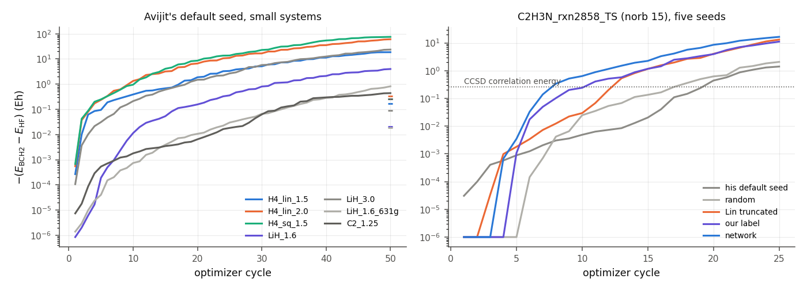
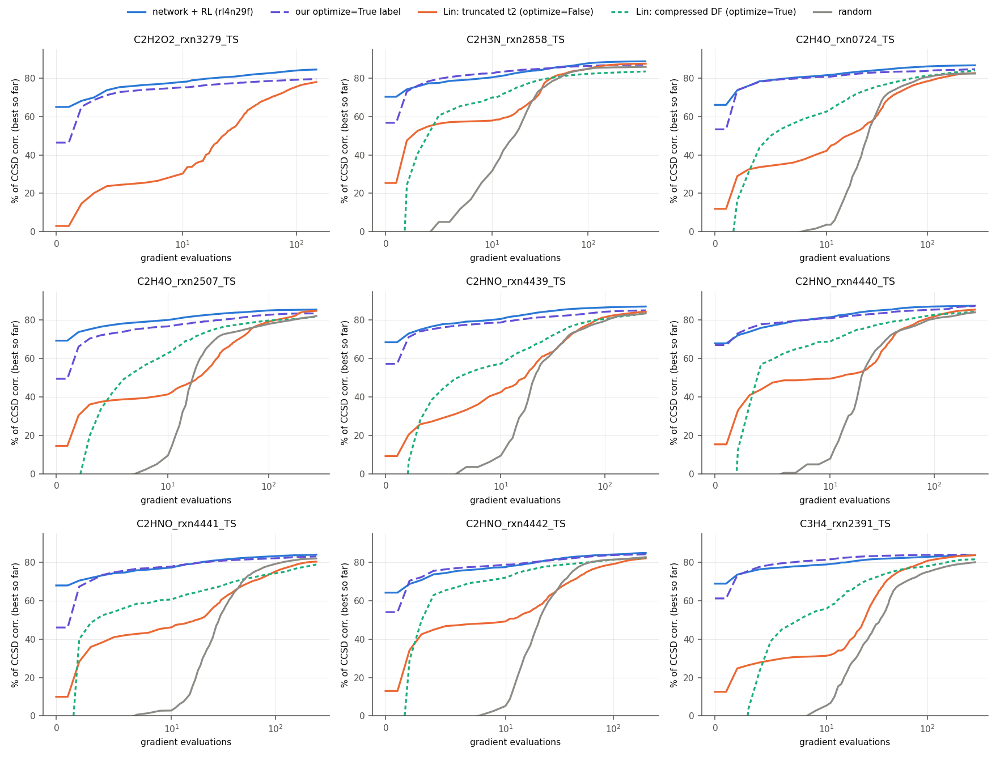
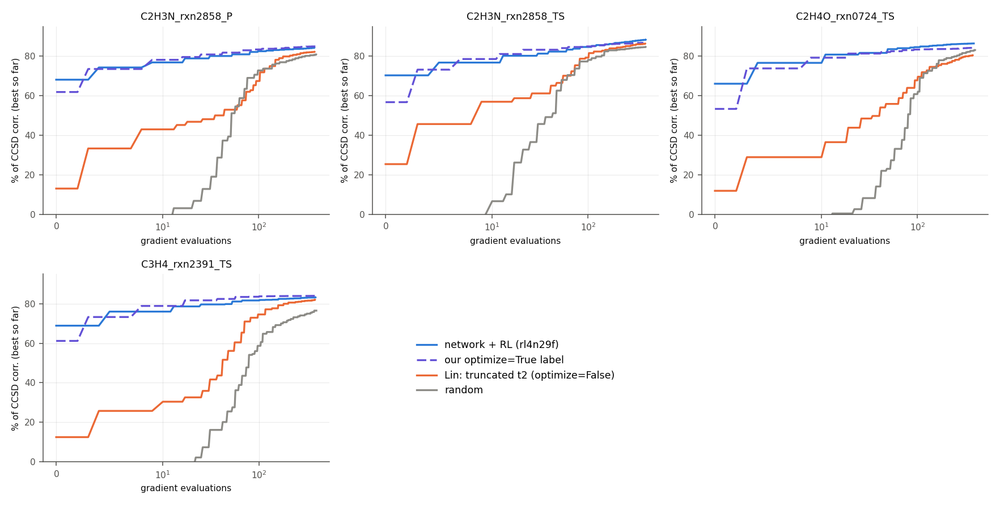

# Network initialization for Avijit's UCJ optimizer

*29 Oct 2026, overnight study for Fang (to forward to Brandon and Avijit). Code: `ucj_init/`. Results:
`pretrain/opt_true/results/ucj_init/`. Logs: `rl_runs/ucj_init/`. Avijit's files (`avijit_simulator/`) are unmodified
(commit 92b76eb). "%" is the share of the CCSD correlation energy recovered (TS molecules) or of the FCI one (small
systems).*

**Task.** Make Avijit's UCJ simulator (`avijit_simulator/UCJ_optimizer.py`) converge better on our Transition1x
molecules. Compare a start from our network's LUCJ parameters with random and naive starts, and with Lin et al.'s
(Wan-Hsuan's) truncated (optimize=False) and compressed (optimize=True) starts.

## 0. Answer

1. **His simulator cannot converge from any start, ours included. The objective has no minimum.**
   * It minimizes the second-order BCH energy. For fixed orbitals that energy is *exactly* E_HF + gᵀM(U)g: a
     quadratic with no linear term.
   * Every stationary point therefore sits at E_HF.
   * Wherever correlation is possible, M has a negative eigenvalue, and the energy falls without bound.
   * This holds on all seven of his test systems (H4, LiH, C2), and on two TS molecules from five starts each.
   * A better start only runs away faster. From our network start, E_BCH2 − E_HF reaches −16.5 Eh after 25 cycles;
     the CCSD correlation energy is −0.26 Eh.
   * This is the "stop and report" case of `UCJ_context.md`: bug in §1, fix in §3.
2. **His ansatz cannot take our network output.**
   * It uses a real orbital rotation, one layer and a spin-free Jastrow. Projected onto it, every network or label
     start lands *above* Hartree–Fock (−28 to −55 %).
   * Exactly optimized, his ansatz holds 52–71 % of the FCI correlation on H4 and 51 % on C2. A complex rotation in
     the same layer holds 90–99 % on H4 (86 % on C2), and our 2-layer LUCJ 100 % (92 % on C2).
   * The cause is the same as in point 1: with real rotations the first-order correlation is zero.
3. **The fix is the exact (variational) energy, in the LUCJ ansatz.**
   * Swapped into his own `RUCJ.kernel`, with nothing else changed, it reaches stationary points on H4 and LiH
     from every start. C2 needs more than his 100-cycle cap.
   * Two cheaper repairs fail:
     * a bounded polynomial completion of BCH2: its minima have the Hartree–Fock energy when evaluated exactly;
     * complex rotations: BCH2 stays indefinite at some rotations.
4. **On TS molecules, with the exact LUCJ energy and exact GPU gradients, our network is the best start we have.**
   * **Against Lin et al.'s starts it wins clearly** (15 molecules, norb 15–18):
     * it starts at 64–78 % before any step, and reaches 80 % in a median 9 gradient evaluations (2–20). Medians
       for the others: Lin's truncated start 84 (15 molecules; one never gets there), Lin's compressed start 82
       (9 molecules; one never gets there), random starts 90 (9 molecules);
     * at a fixed budget of 100 evaluations it is ahead of every Lin and random run (15/15 truncated, 9/9
       compressed, 11/11 random);
     * it also ends higher: above the truncated start on 14 of 15 molecules (tied on 1), above the compressed
       start on 9/9 and above random on 9/9.
   * **With Avijit's own trust-region Newton driver** (§4.2) the gaps grow. Truncated and random starts need a median
     87 and 103 evaluations just to reach 70 %, about 2× and 3× what L-BFGS needs from the same starts. The network
     start needs at most 5 and ends above both on all 4 molecules.
   * **Against our own optimize=True label the gain is real but small.**
     * The network's head start is short-lived. Two gradient evaluations take the label past the network's
       one-call value on 12 of 15 molecules.
     * At norb 15–16 the two trajectories then run within ~2 points of each other. The network is ahead at 100
       evaluations on 6 of 9.
     * At norb 17–18 the network start stays ahead on all 6 molecules, by 0.3–4.8 points at 100 evaluations. The
       largest margin is on the norb-18 TS, 84.0 vs 79.1 %; there the label never reaches 80 % within 150.
     * Final energy: the network is higher on 12 of 15 molecules (tied on 1, lower on 2).
   * **What RL adds is the start, not the end point.** The RL network starts at 65–70 %, against 28–65 % for the
     pretrained network (`pre4`), and so reaches 80 % sooner (median 9 vs 12 evaluations). Both then run into the
     same minimum: on all 9 molecules their final values agree within 0.25 points.
   * **The zero start never moves**: it is a stationary point, the LUCJ version of his g = 0 problem.

**Where the network helps most:**
* on the larger molecules;
* with the trust-region Newton driver, where large early steps are expensive;
* whenever gradients are not available. Task 2 found one network call worth a median 129 SPSA evaluations.

## 1. Why the BCH2 objective cannot converge (the bug)

`_LocalModel.energy_elec` is

  E_BCH2(g, U) = ⟨0|H|0⟩ + ⟨x₀|H|x₀⟩ − ⟨h₀|xx₀⟩,  x₀ = X|0⟩, xx₀ = P X x₀, h₀ = H|0⟩,

with X = R̂(U) Ĝ R̂(U)† and Ĝ = ½ Σ g_pq n_p n_q. X is linear in g, so for fixed U:

* **No linear term.** For real H and real X, ⟨0|[H, X]|0⟩ = 0; the first-order BCH term vanishes identically.
* **Homogeneous quadratic.** E_BCH2 − E_HF = gᵀM(U)g exactly (checked to 1e-13).
* **No stationary point below E_HF.** ∂E/∂g = 2M(U)g = 0 forces E = E_HF.
* **Unbounded below whenever correlation is possible.** If M(U) has a negative eigenvalue, E_BCH2 → −∞ along it.
  A negative eigenvalue is exactly the condition for the UCJ state to lower the energy at small g.
* **It is the exact second-order Taylor polynomial of the exact UCJ energy.** It matches the exact (ffsim) energy of
  the same parameters at O(g²), to 6 digits. The exact energy is even in g; its bound comes from the O(g⁴) terms
  that BCH2 drops.

| system (all electrons) | E(g=0,U) − E_HF | dev. from t² scaling | negative modes of M at his seed | his default run, 50 cycles: E_BCH2 − E_HF | exact energy of that end point − E_HF | FCI corr. |
|:--|--:|--:|--:|--:|--:|--:|
| H4 linear 1.5 Å, STO-3G | 4e-16 | 3e-14 | 2 / 10 | −18.6 Eh | +0.41 Eh | −0.167 |
| H4 linear 2.0 Å | 4e-16 | 2e-14 | 2 / 10 | −60.7 | +0.13 | −0.322 |
| H4 square 1.5 Å | 0 | 1e-14 | 2 / 10 | −75.4 | +0.09 | −0.241 |
| LiH 1.6 Å | 0 | 1e-13 | 3 / 21 | −4.0 | +0.29 | −0.020 |
| LiH 3.0 Å | 2e-15 | 1e-13 | 3 / 21 | −23.6 | +0.07 | −0.088 |
| LiH 1.6 Å, 6-31G | 0 | 3e-14 | 11 / 66 | −0.82 | +0.32 | −0.019 |
| C2 1.25 Å | 7e-14 | 4e-14 | 4 / 55 | −0.44 | +0.18 | −0.269 |

None of these converged, and |g| grew every cycle to 10–30. In the exact energy every end point is *worse than
Hartree–Fock*.

On the TS-set molecules (frozen-core active space, norb 15, 25 cycles; CCSD correlation −0.264 Eh for TS and
−0.223 Eh for P):

| start | E_BCH2 − E_HF, TS | E_BCH2 − E_HF, P |
|:--|--:|--:|
| his default (CISD singles + relaxed-Hgg mode) | −1.4 Eh | −2.7 Eh |
| random | −2.1 | −0.9 |
| Lin truncated, projected (§2) | −13.2 | −1.6 |
| our label, projected | −11.1 | −3.1 |
| our network (rl4n29f), projected | −16.5 | 0.0 (†) |

(†) This one started above E_HF (+0.087 Eh). After 25 cycles it had reached the E_HF level, the only stationary
value BCH2 has, and was just tipping below it.

*Left: −(E_BCH2 − E_HF) per cycle from his default seed. The ticks at the right edge mark each system's CCSD
correlation energy. Right: the TS molecule from five starts; values above E_HF are drawn at 1e-6.*

**What does not fix it.**
* **Complex orbital rotations** (`bch2_complex_check.py`; one layer, random complex U).
  * They give a linear term, b ≠ 0, but M(U) stays indefinite at some rotations. Positive definite at 11 of 16
    random U (H4 ×2, LiH, C2); indefinite at the rest, where BCH2 is unbounded again.
  * Where it is bounded, the fixed-U minimum holds little: −0.003 to −0.010 Eh on C2 (FCI −0.269).
* **A bounded polynomial completion, "RQ2"** (`rq2_test.py`). This is the Rayleigh quotient of the truncated state
  (1 + iX − X²/2)|0⟩ in the CISD space:
  [E₀ + ⟨x₀|H|x₀⟩ − ⟨h₀|xx₀⟩ + ¼⟨xx₀|H|xx₀⟩] / [1 + ¼⟨xx₀|xx₀⟩].
  * It is variational in the CISD space, equals BCH2 to O(g²), and costs one more H application.
  * Its minima (47–99 % of the FCI correlation) sit at large g, where the truncated expansion means nothing.
  * The exact energy at those parameters is 0 ± 1 % on H4 ×3 and LiH ×2.
* **A norm cap on g.** The minimum then sits on the cap, whose radius is arbitrary.

## 2. The integration: our LUCJ output → his (u0, g0)

**Mapping, verified against ffsim.** His state is exp(iX)|HF⟩. In ffsim this is
`UCJOpSpinBalanced(n_reps=1, diag_coulomb_mats=[[g, g]], orbital_rotations=[R.T])`:
* ffsim's U is Rᵀ, because his `_Operator.rotate(R)` uses the rows of R;
* J_αα = J_αβ = g;
* the sign of the exponent does not matter for a real ansatz.

BCH2 equals the O(g²) coefficient of that ffsim energy on all seven systems (`bch2_reproduce.py`).

**Projection** (`bch2_ts.projected_seed`). Our output has two layers, complex U, spin-balanced J on the square
pattern, and a t1 final rotation. His ansatz has none of these. The best simple projection keeps:
* R = polar(Re U₁)ᵀ;
* g = Z₁ on the square pattern;
* no second layer and no final rotation.

It loses everything (`projection_loss.py`; exact energies, the 9 molecules at norb 15–16):

| start | as LUCJ | projected onto his ansatz | layer 1 only, complex U kept |
|:--|--:|--:|--:|
| network (rl4n29f) | 66–78 % | −28 to −44 % | 35–51 % |
| our label | 50–70 % | −28 to −55 % | 10–42 % |
| Lin truncated | 12–25 % | −1 to −2 % | 9–21 % |

LUCJ layers built from t₂ come in complex-conjugate pairs whose product gives real doubles amplitudes at first
order. A real rotation removes that term, as in §1.

**Capacity of each ansatz** (`ansatz_capacity.py`). Exact-energy L-BFGS from 4 random starts plus ffsim's truncated
start (2 + 1 for C2); best value, % of the FCI correlation:

FILL_CAPACITY

## 3. The fix, on his own driver: the exact energy

`ucj_init/exact_model.py` replaces only `_LocalModel` with the exact energy of the same state.
* It uses a dense state vector, autograd, and exact Hessian-vector products at κ = 0.
* `RUCJ.kernel` is unchanged: trust region, Steihaug-CG, accept/reject, his parameterization (accumulated U,
  occupied–virtual κ, packed g) and his convergence tests.
* Results are in `avijit_exact.py` → `avijit_exact.json`.

**Results**: % of FCI correlation reached / cycles used (cap 100). "(grad x)" marks runs stopped above
|grad|∞ = 1e-6. The starts:
* default: his own seed;
* zero: g = 0;
* random: two random seeds;
* truncated and compressed: ffsim optimize=False / optimize=True, one layer, projected as in §2.

FILL_AVIJIT

* **H4 and LiH: every nonzero start ends at a stationary point**, with |grad|∞ 1e-8 to 1e-13 (one LiH run stopped at
  5e-7). His `converged` flag is False on some of them only because his triple test (step < 1e-6, |ΔE| < 1e-9 and
  gradient, all at once) stalls once the trust region cannot lower the energy any further.
* **C2 does not finish in 100 cycles** (|grad|∞ 2e-4 to 1e-2, still descending). Its start dependence is
  as large as H4's: his default seed reaches 16 %, the projected compressed start and the better random seed 53 %.
* **The zero start "converges" at cycle 0 at E_HF.** g = 0 is a stationary point of the exact energy too.
* **The start decides the basin.** Example, H4 at 2.0 Å: his default start 26 %, random starts 22–32 %, the
  projected ffsim compressed start 69 %. Structured starts matter even in his ansatz.
* **Under BCH2 (same starts, same driver), 20 of 24 runs on H4 and LiH diverge**, down to −413 Eh. The other four
  are the zero starts, which "converge" at E_HF. In the exact energy, 19 of the 24 BCH2 end points are above E_HF.

## 4. TS molecules: exact LUCJ energy, exact gradients

**New engine:** `ucj_init/lucj_grad_gpu.py`, the exact energy *and gradient* of our LUCJ (adjoint method, GPU).
* The forward pass and inverse gates reuse the verified energy engine's Givens and phase kernels.
* H·ψ: the same-spin parts come from a dense string-space operator; the opposite-spin part from the energy engine's
  X tile with the full (P|Q) matrix, then one sparse product.
* The orbital gradient comes from spin-summed transition 1-RDMs, chained through U = expm(K) by the adjoint Fréchet
  derivative.
* Validation: against ffsim (complex128) the gradient is right to a relative 1e-6 (norb 8, 10, 12, central
  differences). At norb 15 the energy is within 1e-6 Ha of `gpu_energy`, and directional derivatives match its
  differences.

Cost per energy + gradient:

| norb | TITAN Xp | A100 | H200 |
|:--|--:|--:|--:|
| 15 | 2.1 s | | |
| 16 | 8.1 s | 3.9 s | 1.7 s |
| 17 | | 9.3 s | 4.1 s |
| 18 | | | 11.7 s |

**Optimizers** (`ucj_init/opt_exact.py`):
* L-BFGS-B, memory 20;
* Avijit's trust-region Newton logic, "trn":
  * radius 0.25, max 1.0; accept at ρ ≥ 0.1; ×0.25 / ×2 updates; Steihaug-CG, as in `RUCJ.kernel`;
  * Hessian-vector products by forward differences of exact gradients;
  * Steihaug capped at 20 inner steps (his cap is min(n_params, 50)).

Every gradient evaluation counts toward the budget, the Hessian-vector products included. The final orbital
rotation stays the t1 rotation for every start, as in task 2. Budgets:

| molecules | budget |
|:--|--:|
| norb 15 (C2H3N TS and P) | 400 |
| TS, norb 16 | 300 |
| TS, norb 17 | 250 (200 for rxn4442) |
| P, norb 17 (C2HNO_rxn4440) | 200 |
| R/P, norb 16; TS, norb 18 | 150 |

**Starts** (task-1 candidates: `cands_smallval.pkl`, `cands_n17c2hno.pkl`; norb 18: `ucj_init_n18.pkl`):

| tag | what | build time (norb 15) |
|:--|:--|--:|
| `zero` | U = I, Z = 0 | – |
| `random0`, `random1` | log U and J drawn from 0.1 N(0,1) | – |
| `truncated` | Lin et al.'s truncated t₂ start (ffsim `from_t_amplitudes`, optimize=False) | 2 s |
| `cdf_lin` | Lin et al.'s compressed DF (optimize=True, no regularization) | 42 s |
| `label` | our optimize=True label (regularized compressed DF) | 6 s |
| `pre4` | pretrained network (4 recycles) | 0.2 s |
| `rl4L`, `rl4n29f` | network + energy RL | 0.2 s |

### 4.1 L-BFGS

How to read the paired tables: each start is compared with `rl4n29f` on the molecules where both ran. "% at B" is
the best energy within B gradient evaluations; B = 0 is the start itself.

FILL_LBFGS

*Best-so-far % of the CCSD correlation energy against gradient evaluations (log scale beyond 10), TS molecules.
`pre4` and `rl4L` are omitted: after ~25 evaluations they lie on the `rl4n29f` curve.*

### 4.2 Avijit's trust-region Newton driver

FILL_TRN

**A trust-region Newton method depends more on its start than L-BFGS does.** Its steps are capped at radius 1, and
each step costs up to 21 gradient evaluations. To reach 70 % it needs 1.8–2.5× the evaluations L-BFGS needs from Lin's truncated
start, and 2.2–3.1× from a random start. The network and label starts are within a few steps of the region where it moves fast.

### 4.3 What the starts' orbitals are worth: Jastrow-only optimization

Here the orbital rotations are frozen at the start and only the 2 × (2·norb − 1) Jastrow parameters are optimized
(L-BFGS, converged). This is the setting of hardware experiments that keep the orbitals fixed.

FILL_JONLY

Our two orbital sets (label and network) are about equally good: within 2 points, except C2H4O_rxn2507_TS, where the
network's are 3.8 points better. Lin et al.'s are worse than the better of ours by 14–27 points (compressed DF) and
21–47 points (truncated). The network's
one-call lead over the label therefore comes from its Jastrow factors, not its orbitals. Once the Jastrows are
optimized from the label's orbitals, that lead is gone.

### 4.4 Final energies

Best over the whole run; the budget is the same for every start of a molecule:

FILL_FINAL

`pre4` (the pretrained network) and `rl4n29f` (the same network after energy RL) end within 0.25 points of each
other on all 9 molecules where both ran, although `pre4` starts 5–37 points lower. The two outputs are close: their orbital
parameters differ by ≤ 0.02 and their Jastrows by ≤ 0.1. L-BFGS takes both into the same minimum. RL buys the start.

## 5. Recommendations for Avijit

1. **Replace the objective.** BCH2 has no minimum, and no start can change that.
   * For validation on small systems: the exact energy, a drop-in with his own driver (`exact_model.py`).
   * For our molecules: the GPU engine here, exact to norb 18. Beyond that, our MPS energy engines; gradients there
     would need new work.
   * A polynomial surrogate has to be variational *in the UCJ state*. The truncated-BCH family is not.
2. **Use complex orbital rotations and two layers**, i.e. LUCJ.
   * With real rotations the first-order correlation is zero, and the ansatz holds 52–71 % of the H4 correlation.
   * With LUCJ, our network output is a native start: no projection, 0.2 s per molecule.
3. **Start from our network, or from our label if the network is unavailable.**
   * With exact gradients, both reach 80 % of the CCSD correlation in a median 8–9 evaluations at norb 15–18. The
     exception is the label on the norb-18 TS, which does not get there within 150.
   * Lin et al.'s starts and random starts need a median 82–90.
   * The zero start never leaves Hartree–Fock.
   * The network start ends higher than the label on most molecules, more often at norb 17–18.

## 6. Caveats

* **C2's FCI reference.** PySCF's single-root FCI solve converges to an excited state of C2 (−74.6430 Eh). The
  ground state is −74.6906 Eh: six roots and an independent Lanczos solve agree. All C2 percentages here use the
  ground state (`fix_c2_fci.py`; `common.ref_energies` now solves for 4 roots). H4 and LiH were checked the same way.
* **Precision.** Gradients are complex64/float32: ~1e-6 relative, 1e-6 Ha in the energy. No run reaches a gradient
  norm below ~1e-3, so "final" means the best within the budget, not a converged minimum.
* **Seeds.** One optimizer run per (molecule, start). Random starts: one seed, two for C2H3N. Budgets differ between
  molecules (§4).
* **The final orbital rotation stays the t1 rotation for all starts.** Optimizing it as well (Lin et al. do) adds
  norb² parameters per molecule.
* **Molecules.** 15 molecules: 9 at norb 15–16 (small_val), 5 at norb 17 (4 C2HNO TS + 1 P), 1 at norb 18
  (C2H2O2 TS). Not every start ran on every molecule (see the `molecules` column of each table). Small-sample
  statements are win counts, not significance tests.
* **Small systems.**
  * His seeds and starts are all-electron; the TS runs use our frozen-core active space (`active_mf`). He uses
    PySCF's CISD space, all electrons.
  * C2 under his driver stops at the 100-cycle cap.

## 7. Files

| file | what |
|:--|:--|
| `ucj_init/common.py` | loads his module (the folder's `__init__` imports a nonexistent `pyscf.ucj`); `ao2mo` shim and `active_mf` (his optimizer on our frozen-core active spaces); ffsim energy of his ansatz |
| `ucj_init/bch2_reproduce.py` | claims 1–3 + Taylor check + default runs, 7 small systems |
| `ucj_init/bch2_ts.py` | his optimizer on TS molecules from 5 starts; `projected_seed` (our LUCJ → his u0, g0) |
| `ucj_init/bch2_complex_check.py`, `rq2_test.py` | the two candidate repairs that fail |
| `ucj_init/exact_model.py`, `avijit_exact.py` | exact-energy `_LocalModel` for his kernel; runs |
| `ucj_init/ansatz_capacity.py`, `projection_loss.py` | ansatz capacity; projection loss |
| `ucj_init/lucj_grad_gpu.py`, `test_lucj_grad.py`, `check_ts_grad.py`, `profile_grad.py` | GPU adjoint LUCJ gradient, validation, profiling |
| `ucj_init/opt_exact.py` | runs: L-BFGS, trust region (`--method trn`), Jastrow-only (`--jastrow-only`) |
| `ucj_init/worker.sh`, `chain_worker.sh` | lock-based job queue |
| `ucj_init/report_exact.py`, `report_small.py`, `make_figs.py` | tables and figures |
| `rl_runs/ucj_init/exact_opt/*.jsonl` | every evaluation of every run |
| `pretrain/opt_true/results/ucj_init/exact_opt/*.json`, `*.npz` | summaries; start and best parameters |
