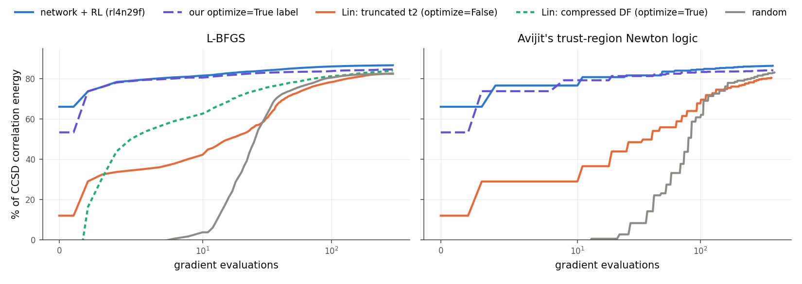

# Avijit's optimizer, our network, and next steps

### Discussion with Brandon · 29 Oct 2026

 

1. What Avijit wants, and why his optimizer cannot converge
2. What we got out of his code, and what our pipeline already provides
3. Back to our goal, beating CCSD: CCSD vs FCI on TS, then VQE and QSD

Fang Sun · full report: `ccsd_amplitudes/docs/ucj_init/report.md`

---

## 1 · What Avijit wants

* Optimize UCJ parameters to minimize the molecular energy
* Without simulating the full quantum state: he uses a cheap **approximate energy** (polynomial cost), so the method could scale to large molecules
* Problem: **his optimizer never converges**
* His question to us: does our network's output give a better starting point?

---

## 1 · His approximate energy: a truncated BCH expansion

* His state is $|\psi\rangle = e^{iX}|\mathrm{HF}\rangle$. $X$ is built from
  * $U$: an orbital rotation (a real matrix)
  * $g$: the Jastrow parameters ($g_{pq}$ multiplies the pair term $n_p n_q$; $n_p$ = occupation of orbital $p$)
* True energy $E = \langle \mathrm{HF}|\, e^{-iX} H e^{iX} \,|\mathrm{HF}\rangle$: needs the full state, exponential cost
* **BCH expansion**: write $e^{-iX} H e^{iX}$ as a series of nested commutators and stop after the $X^2$ term:

$$E \approx E_{\mathrm{HF}} \;-\; i\,\langle[X,H]\rangle \;-\; \tfrac12\,\langle[X,[X,H]]\rangle$$

* These terms only need $X|\mathrm{HF}\rangle$ and $X^2|\mathrm{HF}\rangle$ in the singles + doubles (CISD) space: polynomial cost
* In effect: a **second-order Taylor expansion of the true energy around Hartree–Fock** ($g = 0$)

---

## 1 · Why it cannot converge: the approximation has no minimum

* For his real $U$ the first-order term $\langle[X,H]\rangle$ is zero. $X$ is linear in $g$, so for fixed $U$ the approximate energy is exactly

$$E_{\mathrm{BCH2}}(g) = E_{\mathrm{HF}} + g^{\mathsf T} M(U)\, g$$

($E_{\mathrm{HF}}$: Hartree–Fock energy; $g$: all Jastrow parameters as one vector; $M(U)$: a fixed matrix for a given $U$, from the commutator term)

* The only flat point is $g = 0$, i.e. Hartree–Fock
* Whenever correlation can lower the energy, $M$ has a negative eigenvalue. Along that direction the energy keeps falling as $g$ grows: **no lowest point, so the optimizer never stops**
* Like minimizing $1 - x^2/2$ instead of $\cos x$

---

## 1 · Why not stay near the expansion point?

* The approximation is accurate only near $g = 0$; its error grows like $|g|^4$
* Near $g = 0$ it only slopes downward: inside any neighborhood its lowest point is **on the edge**
* His optimizer already moves in neighborhoods (a trust region), but checks each step against the approximation itself, so every step looks good. On the TS molecule every step was accepted, the neighborhood grew to its maximum size, and $|g|$ went from 0.8 to 11.5 in 25 steps
* The true minimum lies where the dropped higher-order terms are as large as the kept ones, i.e. **outside** the region where the approximation holds. For $\cos x$: the minimum is at $x = \pi$, where $1 - x^2/2 = -3.9$ instead of $-1$
* Capping $|g|$ just puts the minimum on the cap, at whatever radius was chosen

---

## 1 · Evidence, and why our network start did not help

Energies relative to Hartree–Fock, in Eh. Lower is lower energy, but **nothing can go below the exact (FCI) energy**.

| run | where his approximate energy ended | lowest physically possible (correlation energy) |
|:--|--:|--:|
| H4, 3 geometries (his own start, 50 steps) | −18.6 to −75.4 | −0.17 to −0.32 (FCI) |
| TS molecule C2H3N (**our network start**, 25 steps) | −16.5 | −0.26 (CCSD) |

* His runs went 60–300× below what is physically possible: the numbers are meaningless, not "good"
* With the true energy, every end point is **above Hartree–Fock**, worse than no correlation at all. Same on all 7 of his test systems
* **No start can fix an objective with no minimum, ours included.** A better start only runs away faster
* Training our network on this objective would make it worse

---

## 2 · Using his code as a starting point

* Replaced his approximate energy with the **exact energy**, and his ansatz with our **2-layer LUCJ** (his real, 1-layer ansatz holds only 52–71 % of the H4 correlation; LUCJ 100 %)
* **This is now a standard exact LUCJ optimization** (full state vector, like ffsim). Exponential cost, ~18–20 orbitals at most. Nothing of Avijit's method is left except his optimizer loop (trust-region Newton), and that needed ~2× more evaluations than plain L-BFGS
* What it is good for: a clean test of whether our network gives a better **starting point for optimization**
* New tool from this: exact LUCJ energy + gradient on GPU, up to 18 orbitals (1.7 / 4.1 / 11.7 s per evaluation at 16 / 17 / 18 orbitals, H200)
* Test set: 15 Transition1x molecules (reactants, TSs, products; 15–18 orbitals)

---

## 2 · The five starting points

| start | what it is | time per molecule |
|:--|:--|--:|
| **network (NN + RL)** | our network, one forward pass. Pretrained on the compressed-DF objective, then fine-tuned with RL on the energy | 0.2 s |
| our optimize=True label | ffsim's compressed double-factorization fit of the CCSD t₂, **with** a regularizer that keeps the Jastrow terms small (500 iterations) | 6 s |
| Lin, compressed DF (optimize=True) | the **same fit** with Lin et al.'s settings: **no** regularizer, 100 iterations. The Jastrow terms grow large and the 2-layer state ends above Hartree–Fock | 42 s |
| Lin, truncated t₂ (optimize=False) | eigendecomposition of t₂, truncated to 2 layers; no fitting | 2 s |
| random | random parameters (scale 0.1) | – |

Times at 15 orbitals.

---

## 2 · Result: the network start needs ~10× fewer gradient evaluations

| start | % of CCSD correlation at the start (↑) | L-BFGS: evaluations to reach 80 % (↓) | trust region: evaluations to reach 70 % (↓) |
|:--|--:|--:|--:|
| **network (NN + RL)** | 64 – 78 | **9** | **4** |
| our optimize=True label | 46 – 72 | 8 | 3 |
| Lin, compressed DF | below 0 | 82 | not run |
| Lin, truncated t₂ | 3 – 25 | 84 | 87 |
| random | below 0 | 90 | 103 |

↑ higher is better: 100 % = CCSD energy, 0 % = Hartree–Fock, below 0 = worse than Hartree–Fock. ↓ fewer is better; one evaluation = one exact energy + gradient. Medians over the molecules.

* Read: from the network start, L-BFGS needs 9 evaluations to recover 80 % of the CCSD correlation energy; from Lin's truncated start, 84
* Final energy: network above Lin's starts on 14/15 (truncated) and 9/9 (compressed); above our label on 6/6 at 17–18 orbitals

---

## 2 · One molecule: C2H4O TS, 16 orbitals

y: best % of the CCSD correlation energy reached so far (higher is better). x: gradient evaluations, log scale. The compressed-DF start was not run with the trust-region optimizer.

---

## 2 · Our pipeline is already self-contained

| piece | what it does | range |
|:--|:--|:--|
| network | CCSD amplitudes → native LUCJ parameters, 0.2 s per molecule | 15–44 orbitals |
| exact engine | LUCJ energy on GPU | ≤ 19 orbitals |
| exact gradient (new) | energy + gradient on GPU | ≤ 18 orbitals |
| tensor-network engines | approximate MPS energy; MPS sampling | 44 orbitals; 58 qubits |
| optimizers | L-BFGS, trust-region Newton (Avijit's), RL (GRPO) | |
| evaluation | SQD/QSCI with Lin et al.'s protocol; CCSD(T) and FCI references | |

* Objectives already plugged in: compressed-DF fit (pretraining), variational energy (RL), SQD/QSCI, exact-gradient optimization, Avijit's optimizer
* A new objective (VQE, QSD, a bounded BCH-type approximation) only needs its loss. The network, engines and evaluation stay the same

---

## 3 · Our goal is beating CCSD. Is there room on TS?

FCI already exists for 9 molecules (15–16 orbitals, computed 5 Oct). Error against FCI, in mEh (lower is better, 0 = exact; 1 mEh = 0.63 kcal/mol):

| molecules | CCSD | CCSD(T) | 2-layer LUCJ after optimization (part 2) |
|:--|--:|--:|--:|
| 4 TS | **7.8 – 14.2** (mean 11.6) | 1.7 – 3.8 (2.7) | 37 – 53 (44) |
| 5 reactants / products | 3.2 – 8.1 (4.9) | 0.9 – 2.0 (1.3) | 31 – 39 (35) |

* On TS, CCSD is off by **5–9 kcal/mol**, 2.4× its error on reactants and products. Beating CCSD on TS is a meaningful target
* Only 4 TS so far. **Next: FCI for all TS at 17–18 orbitals** (feasible), plus T1/D1 diagnostics, to define a hard-TS subset

---

## 3 · Direction 1: VQE

* Our network makes the optimization ~10× cheaper (part 2)
* But 2-layer LUCJ ends 31–53 mEh above FCI, far above CCSD (3–14 mEh)
* VQE can only beat CCSD with a bigger ansatz: more layers, an optimized final orbital rotation. That is the first test

---

## 3 · Direction 2: QSD

* **QSD** (Krylov / quantum subspace diagonalization) diagonalizes H in a subspace built from one initial state ψ₀
* Its convergence depends on the overlap of ψ₀ with the true ground state, so **the start matters directly**
* SQD does not reward a good start:
  * at 10⁶ samples every start already lands 0.7–2.6 mEh above FCI, below CCSD
  * the best there is Lin's compressed DF, whose own energy is 1.1 Eh above FCI
  * the SQD error follows the number of distinct sampled configurations (correlation −0.96), not the state's energy
* First test: overlap of network, label and Lin states with the FCI ground state (9 molecules), then the simulated QSD error vs subspace size

---

## Ask

**Brandon's QSD code.** Fang will adapt it to our pipeline: network states as ψ₀, our GPU and tensor-network engines, FCI references.

 

Plan:

1. CCSD vs FCI on all TS molecules (17–18 orbitals)
2. Overlap test and simulated QSD on the FCI-size molecules, network vs Lin vs label
3. VQE with a larger LUCJ ansatz, starting from the network
