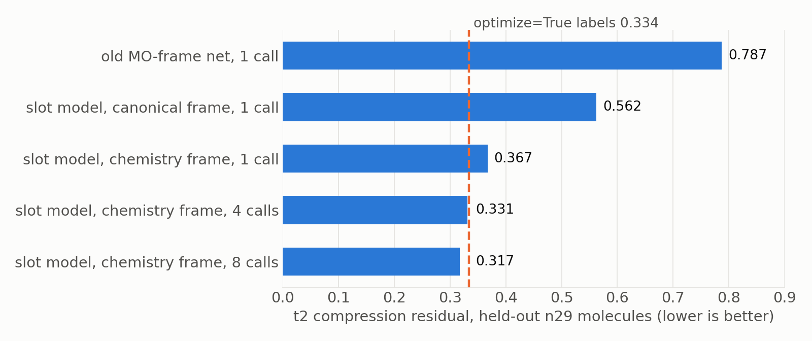
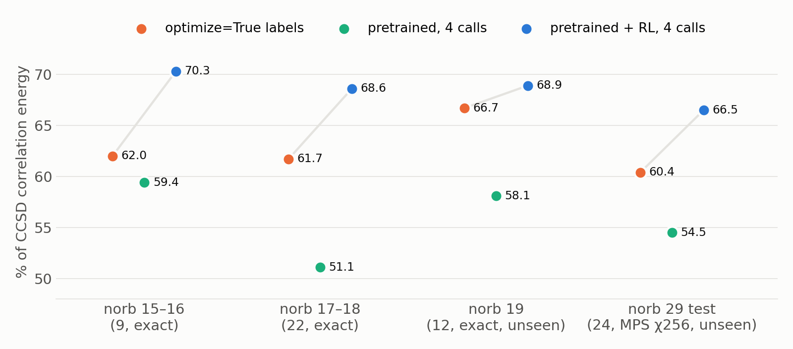
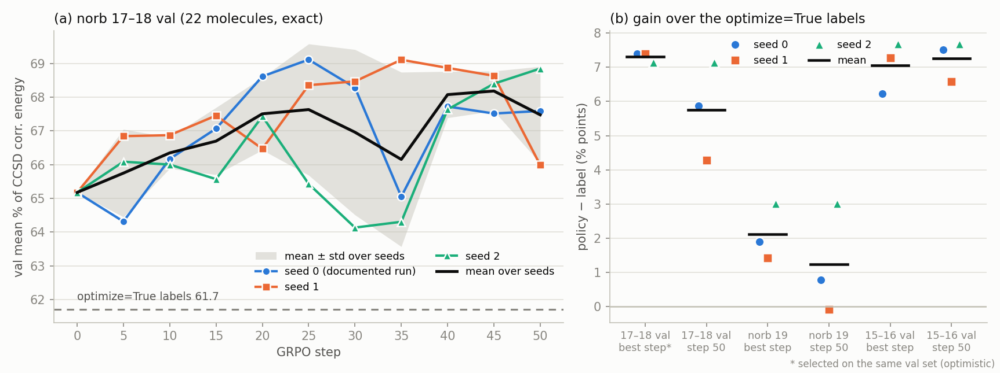
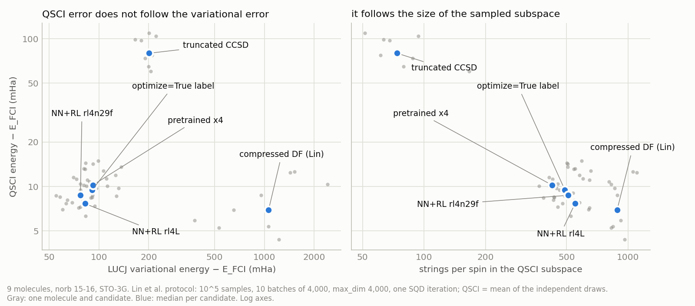

# ML-LUCJ v5
## Learning optimize=True LUCJ parameters: pretraining, energy RL, and SQD

 

**From "not learnable" to one network call that beats per-molecule optimization**

Fang Sun · October 2026 · follow-up to deck_v4 · code and docs in `ccsd_amplitudes/`

---

## The goal

CCSD amplitudes t₁, t₂

→

network (one call, 0.2 s)

→

LUCJ circuit U, J (2 layers)

→

energy · SQD · QPU

 

* Replace per-molecule optimization (minutes to hours) with **one network call**
* Data: Transition1x reactants, products and TSs: **30,205 molecules, 15–44 orbitals (30–88 qubits)**
* Quality measure: % of the CCSD correlation energy the circuit recovers

---

## Where we were (decks v3 and v4)

| target | what it is | learnable? |
|:--|:--|:--|
| **optimize=False** (truncated DF) | deterministic linear algebra of t₂ | yes, once the gauge is removed (v3) |
| **optimize=True** (compressed DF, Lin et al.) | argmin of a non-convex fit | no (v4) |

* optimize=True gives much better circuits, but:
  * 10 restarts give 10 different minima at equal residual
  * so the label is **not a function of t₂**

---

## The network *can* fit the labels; it just can't generalize

Memorizing the literal optimize=True labels (old MO-frame network):

| training molecules | 16 | 64 | 256 | 1,269 |
|:--|--:|--:|--:|--:|
| distance of U to the label (train) | 0.003 | 0.014 | 0.040 | 0.034 |
| held-out residual | 0.93 | 0.93 | 0.89 | 0.87 |

* Near-identical inputs carry labels ΔU ≈ 0.6 apart
* **The problem is the target, not the network.**

---

# Part I: Pretraining
## Rebuilding the training objective

---

## Idea 1: learn the objective, not the argmin

* Drop the labels. Train directly on **ffsim's compressed-DF objective**:
  $\;\min_{U,J}\ \lVert t_2 - t_2(U, J)\rVert + \lambda\,\text{reg}(J)$
* For a given U, the best J is a linear least-squares problem → **solve J exactly** (variable projection)
* The network only predicts U; gradients pass through the inner minimum (Danskin)

 

**Every molecule now has one well-defined target value, even though its argmin is not unique.**

---

## Idea 2: the right coordinate frame

* Observation: optimize=True orbitals are **atom-centred hybrids**, with a fixed ∓π/4 phase between occupied and virtual blocks
* Build that frame from the **geometry**: valence AOs → orthonormalize → bond-directed hybrids
* Parameterize $\;U_k = \Phi_k\, B_k\, e^{A_k}$, with $A_k$ real antisymmetric and small

| starting point | t₂ residual (n29, median) |
|:--|--:|
| canonical init (optimize=True's start) | 0.807 |
| chemistry frame alone, A = 0 | 0.501 |
| chemistry frame + optimization | **0.290** |
| optimize=True labels | 0.334 |

---

## Idea 3: a learned optimizer in that frame

* Tokens = **orbital pairs (p, q)** of the current iterate
* Inputs in the same frame: t₂ projections, residual, gradient, chemistry (element, hybrid, bonds)
* Output: a rotation step $U \leftarrow U\, e^{\Delta K}$
* **Recycle** T times (T = 1, 4, 8)

current U (chemistry frame)

↓

pair-token transformer

↓

ΔK → U e^ΔK, J re-solved

↻ T times

---

## Pretraining result: label quality on unseen molecules

* Trained on all 30k molecules, no labels. Held-out molecules with no near-duplicate in training: 1 call **0.377**, 8 calls **0.317**
* Residual: 0.787 → **0.317**, below the labels

---

## But a low residual is not a low energy

Held-out molecules at 15–16 orbitals, exact energies (% of CCSD correlation energy, median):

| candidate | median |
|:--|--:|
| canonical init | 14.3 |
| pretrained, 1 call | 55.7 |
| pretrained, 8 calls | 59.6 |
| **optimize=True labels** | **67.6** |

* At equal residual, our basin is 2–5 points worse in energy
* → **Optimize the energy itself: RL post-training**

---

# Part II: RL post-training

---

## GRPO on the LUCJ energy

* **Policy**: the pretrained slot model plus a J-correction head. Gaussian exploration on the frame generators, mirrored pairs
* **Reward**: % of CCSD correlation energy of the LUCJ state
* Groups of 8 samples per molecule; group-normalized advantages; **one on-policy update** per batch
* 4-recycle model: 3 frozen pretrained calls + 1 trainable call

First run (9 held-out molecules, 15–16 orbitals): **54.5 → 64.6 %** for one call and 59.4 → **67.4 %** for 4 calls. The labels give 62.0 %.

---

## Making the reward affordable at scale

| engine | reach | cost per energy |
|:--|:--|:--|
| CPU statevector (before) | ≤ 17 orbitals | 10–45 min |
| **exact GPU engine** (new) | ≤ 19 orbitals (38 qubits) | 3 s (17) · 9–23 s (18) · 54 s (19) |
| **MPS engine** (new) | 29–44 orbitals (58–88 qubits) | ~1 GPU-min (χ128) |

* GPU engine: matches ffsim to 1e-7 Ha; 230–740× faster than one CPU core
* MPS: localized orbitals + exact gate MPOs; χ128 is within ~1 mHa of χ256 up to 44 orbitals
* Rewards spread over lab GPUs via a file queue, and over CPU nodes on Expanse

---

## RL results across sizes

* One policy: RL on 15–18 orbitals (exact rewards), then 29 orbitals (MPS rewards, Expanse)
* 19-orbital molecules and the 29-orbital test set were **never used for training or selection**; at 29 orbitals the policy beats the labels on **24/24** molecules

---

## How robust are the gains?

* **3 random seeds** at 17–18 orbitals: **+5.7 ± 0.7** points over the labels
  * the +7.4 we first quoted was inflated by picking the best checkpoint on the same set
  * 19 orbitals: **+2 ± 1**
* **Converged labels** (5,000 L-BFGS iterations instead of 500): 61.03 → 61.06 %
  * the network still wins on **78–79 of 87** molecules
* **MPS truncation** at 29 orbitals: the gap is the same at χ128 / χ256 / χ256 with a larger zip margin (**+6.0 / +5.9 / +5.9**)

---

## Seed-to-seed spread (norb 15–18 RL, exact rewards)

---

## One call vs per-molecule optimization

9 molecules, 15–16 orbitals, 500 energy evaluations per molecule:

| method | time per molecule | % CCSD corr |
|:--|--:|--:|
| optimize=True label → NOMAD (Lin et al.'s settings) | 11–27 min | 62.0 → 63.9 |
| **network, one call** | **0.19 s** | **70.3** |
| label → SPSA | 6–28 min | 73.8 |
| network → SPSA | 6–28 min | 75.8 |

* The network beats a 500-evaluation NOMAD run from a single call
* SPSA still finds 5–10 points more: **headroom for RL**

---

# Part III: Quantum algorithms
## SQD / QSCI, following Lin et al. (arXiv:2511.22476)

---

## The test: Lin et al.'s noiseless protocol

* Exact LUCJ state → **10⁵ samples** → 10 batches of 4,000 → QSCI subspace → diagonalize
* Same settings as her paper (max_dim 4,000; one SQD iteration)
* 9 molecules at 15–16 orbitals (FCI reference) and 9 at 17 orbitals (CCSD(T) reference)
* Candidates: truncated CCSD · **Lin's compressed DF** · optimize=True label · pretrained · **network + RL**

Question: **does a better variational energy give a better QSCI energy?**

---

## Answer: no. QSCI follows the number of sampled configurations

* Variational order vs QSCI order: pooled Spearman **−0.09**
* Among reasonable states, the QSCI error tracks the distinct strings sampled (ρ **−0.96**)

---

## QSCI errors (mHa above FCI, 9 molecules, 15–16 orbitals)

| candidate | LUCJ % corr | QSCI, 10⁵ samples | QSCI, 10⁶ samples |
|:--|--:|--:|--:|
| truncated CCSD | 17 | 85.0 | |
| Lin's compressed DF | **−401** (above HF) | **8.0** | **0.69** |
| optimize=True label | 62 | 10.1 | 2.55 |
| network + RL (rl4L) | 68 | **8.6** (beats label 8/9) | 2.08 |
| network + RL (rl4n29f) | **70** | 10.0 | 2.58 |
| *CCSD / CCSD(T)* | | *7.9 / 1.9* | |

At 17 orbitals the ranking is the same: compressed DF 8.7, rl4L 9.2, label 10.7 mHa (vs CCSD(T)).

---

## Verdict against Lin et al.

| | ours | Lin et al. | |
|:--|:--|:--|:--|
| variational energy | **70 %** in one call | below HF (compressed DF); 64 % after NOMAD | far ahead |
| QSCI, 10⁵ samples | 8.6 mHa | 8.0 mHa | level |
| QSCI, 10⁶ samples | 2.08 mHa | 0.69 mHa | behind |

* The energy reward is the **wrong proxy for SQD**: RL made the states more concentrated
* To win on SQD, the reward must score QSCI energy or configuration coverage. At 15–17 orbitals that costs ~10 s of GPU plus 20–50 s of CPU per reward

---

## Scaling SQD to 58 qubits: MPS sampling

* New **MPS sampler**: perfect sampling on the GPU; 10⁵ samples in 0.5–2 s at 29 orbitals
* QSCI bias from MPS samples vs exact samples (15–16 orbitals):

| χ | 64 | 128 | 256 | 512 |
|:--|--:|--:|--:|--:|
| QSCI bias (mHa) | +1.65 | +0.67 | +0.20 | **0.00 ± 0.11** |

* Works end to end at 29 orbitals. Lin et al. used χ = 50 inside their optimization loop
* Bottleneck: each subspace holds **1–2 M determinants** → needs the GPU SQD solver (SBD)

---

## Caveats

* **Reaction barriers**: 2-layer LUCJ overestimates barriers by ~15 kcal/mol against CCSD(T). CCSD is at 4.6
  * policy 14.5 · labels 17.0 · HF 20.8 kcal/mol (10 reactions, 17–19 orbitals)
* Ansatz differs from Lin et al.: ours is 2-layer square, hers 1-layer heavy-hex. The molecules differ too
* All quantum results so far are noiseless simulations. No QPU runs yet
* Beyond 19 orbitals we have no FCI-quality reference

---

## Next steps

1. **QSCI-aware RL reward**: the QSCI energy itself, or energy plus a coverage term
2. **GPU SQD solver (SBD)** → TN-sampled SQD at 29–44 orbitals
3. **Heavy-hex variant** of the policy → IBM QPU runs (Lin et al.'s hardware protocol)
4. Larger RL batches at 29 orbitals (the χ64 reward already ranks groups correctly)
5. Compute: 2027 NERSC request of **10,000 GPU node-hours** (RL rewards, SQD/QSD tests)

---

# Summary

* **Pretraining**: learn the *objective*, not the argmin, in a *chemistry frame*, with a *learned optimizer*. optimize=True quality becomes learnable: residual 0.317 vs labels 0.334
* **RL**: the energy reward lifts one network call above per-molecule optimize=True at every size from 15 to 29 orbitals (+5.7 ± 0.7 points at 17–18; 24/24 at 29)
* **SQD**: a better variational energy ≠ a better SQD energy. We are level with Lin et al. at 10⁵ samples and behind at 10⁶. A QSCI-aware reward is the next step
